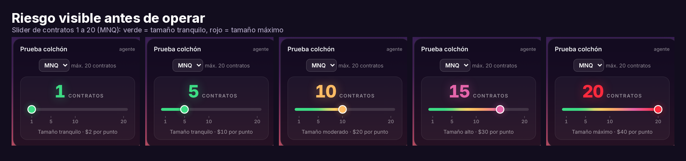
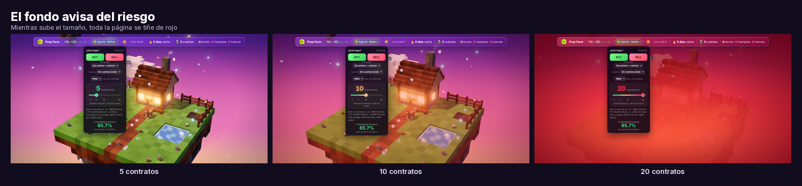
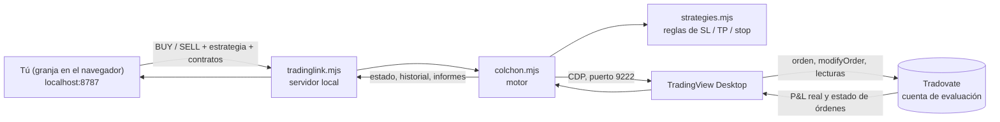

<p align="center">
  
</p>

<p align="center">
  
  
  
  
  
</p>

# Prop Farm · AI-Profit (TradingLink)

**Hecho por Ai Profit Camp.**

Para uso diario: ver [LEEME.md](LEEME.md).

**Prop Farm** es una aplicación web local que gestiona una *granja* de cuentas de evaluación de firmas de fondeo (Lucid, Tradovate) y trae un **motor de ejecución** que habla con TradingView Desktop y con Tradovate para abrir, ajustar y vigilar órdenes de **MNQ / NQ**.

Todo corre en tu propia PC con Windows. La página se sirve en `http://localhost:8787`, los datos de las cuentas se quedan en tu carpeta y este repositorio **no contiene** saldos, cuentas, historial ni claves.

> **Quién la usa:** el equipo de Ai Profit Camp (Bänéd y Caroline), cada uno en su PC, y los agentes (Grok) que los ayudan. Las reglas para los agentes están en [`AGENTS.md`](AGENTS.md).

---

## Contenido

- [Características](#características)
- [Riesgo a la vista](#riesgo-a-la-vista)
- [Cómo funciona](#cómo-funciona)
- [Estrategias](#estrategias)
- [Estructura del repositorio](#estructura-del-repositorio)
- [Instalación y actualización](#instalación-y-actualización)
- [Seguridad y reglas](#seguridad-y-reglas)
- [Estado y hoja de ruta](#estado-y-hoja-de-ruta)
- [Aviso](#aviso)

---

## Características

| | |
|---|---|
| **Granja de cuentas** | Vista de todas tus cuentas de evaluación y fondeadas, con metas, rachas y jardín de logros. Las cuentas quemadas se apartan solas. |
| **Motor de ejecución** | Abre una orden a mercado con bracket (SL y TP), vigila la posición cada 0.5 s y mueve el stop según la estrategia elegida. |
| **Ajuste al precio real** | Una orden a mercado puede llenarse unos ticks peor que la referencia. El motor recalcula SL y TP desde el **fill real**, sobre la misma orden, sin cancelar ni recrear nada. |
| **Stop por `modifyOrder`** | El stop se mueve modificando la orden existente en Tradovate y se verifica leyéndola de nuevo. |
| **P&L real del bróker** | En modo `broker` el P&L sale directamente de Tradovate (eventos de posición y lectura de posiciones), no del gráfico. |
| **Slider de contratos 1 a 20** | Por defecto 5. Del verde al rojo según el tamaño, y el fondo de la página se tiñe de rojo al subir el riesgo. |
| **Historial** | Trades del día con hora ET, dirección, contratos, resultado y cuenta enmascarada (4 primeros y 3 últimos caracteres). |
| **Luces de conexión** | Servidor, TradingView (CDP 9222) y Tradovate, siempre visibles en la barra superior. |
| **Actualización segura** | `acceso/actualizar.bat` descarga Git portátil, respalda lo que va a reemplazar y nunca toca tus archivos personales. |

<p align="center">
  
  <br>
  <sub><b>La granja:</b> cada cuenta es una planta en tu isla, y las cuentas fondeadas florecen en el Jardín de logros.</sub>
</p>

---

## Riesgo a la vista

Antes de pulsar BUY o SELL ves cuánto estás arriesgando. El tamaño se elige con un slider de **1 a 20 contratos** (por defecto **5**). El color y el texto cambian del verde al rojo, y muestran cuánto vale cada punto de MNQ ($2 por contrato).

<p align="center">
  
</p>

Además, el fondo de toda la página se tiñe de rojo mientras sube el tamaño, para que el riesgo se note sin leer ningún número.

<p align="center">
  
</p>

Con la misma pérdida máxima en dólares, más contratos significan un stop más cerca. Ejemplo con SL de −$600 en MNQ (**ejemplo**, la fórmula es `puntos = USD / (2 × contratos)`):

| Contratos | Valor por punto | Stop de −$600 equivale a |
|:-:|:-:|:-:|
| 5 | $10 | 60 puntos |
| 10 | $20 | 30 puntos |
| 20 | $40 | 15 puntos |

> Las capturas son de la granja sin cuentas cargadas (modo de demostración), sin saldos ni ids reales.

---

## Cómo funciona



1. **Elegir.** En la granja eliges estrategia, cuenta, símbolo y contratos, y pulsas BUY o SELL. Solo tú inicias un trade.
2. **Abrir.** El motor envía **una** orden a mercado con SL y TP calculados desde el precio de referencia. La colocación nunca se reintenta: si falla, se informa y se detiene.
3. **Ajustar al fill.** Con el precio real de entrada, recalcula SL y TP y los modifica sobre la misma orden.
4. **Vigilar.** Cada 0.5 s lee posición, stop y P&L. Cuando se cumple el disparo de la estrategia, mueve el stop con `modifyOrder` y lo confirma.
5. **Cerrar y registrar.** Al quedar plano, guarda el resumen, el historial del día y un informe en `reportes\`. Todos los tiempos van en segundos y las horas en ET.

El motor usa la **misma conexión que ya tiene tu TradingView Desktop**: no guarda contraseñas ni claves de Tradovate.

---

## Estrategias

Se definen en [`motor/strategies.mjs`](motor/strategies.mjs). Añadir una nueva es crear una entrada más en `STRATEGIES`; la página la lista sola.

| Id | Nombre | Qué hace |
|---|---|---|
| `dia-minimo-colchon` *(por defecto)* | Día mínimo + colchón | SL −$600 / TP +$1,600. Al llegar al disparo, el stop sube para asegurar unos +$100 netos (colchón = $100 + comisiones + 1 tick, redondeado arriba a tick). 5 MNQ por defecto. |
| `prueba-be` | PRUEBA BE | SL −$630 / TP +$630. A +$15 el stop pasa a la entrada (*break even*). 5 MNQ por defecto. |
| `evaluacion` | Trailing stop loss: Evaluación | SL −$630 / TP +$630 con stop escalonado: a +$150 protege +$100, a +$250 protege +$200 y a +$350 protege +$300. |
| `evaluacion-simple` | Evaluación | SL −$630 / TP +$630. El stop no se mueve nunca. |

Tope de tamaño: 20 MNQ o 2 NQ.

---

## Estructura del repositorio

```text
AI-Profit/
├── motor/Granja-de-Cuentas-v2.html   La página (granja, slider, historial)
├── motor/tradinglink.mjs             Servidor local en 127.0.0.1:8787 y API
├── motor/colchon.mjs                 Motor de ejecución (CDP, stop, P&L)
├── motor/orders.mjs                  Órdenes manuales con confirmación
├── motor/strategies.mjs              Registro de estrategias
├── motor/negocio.mjs                 Copia del historial del Negocio (negocio.json)
├── motor/probe.mjs · motor/busy.mjs  Herramientas de lectura (¿está libre la cuenta?)
├── acceso/abrir-tradingview.bat      Abre TradingView Desktop con el puerto 9222
├── acceso/iniciar-tradinglink.bat    Arranca el servidor y abre la granja
├── acceso/actualizar.bat / .ps1      Actualización segura desde este repositorio
├── motor/colchon-src/                Fuentes de la UI del motor y pruebas simuladas
├── tradingview-mcp/                  Herramientas de apoyo para TradingView
├── docs/                             Documentación adicional
├── docs/MOTOR.md                     Guía técnica completa del motor
├── LEEME.md · docs/LEEME-ACTUALIZAR.md
├── AGENTS.md                         Reglas para cualquier agente
├── docs/INSTRUCCIONES-GROK.md        Pasos para el agente de Caroline
└── assets/                           Imágenes de este README
```

Los archivos personales de cada PC (`accounts.json`, `sod.json`, `negocio.json`, `logros.json`, `metas.json`, `real-allowlist.json`, `historial/`, `backups-negocio/`, `reportes/`, `backups/`, `colchon-*.json*`, `*.log`) están en `.gitignore` y **nunca** se suben.

---

## Instalación y actualización

### Requisitos

- Windows 10 u 11.
- **TradingView Desktop** (Microsoft Store) con la cuenta de Tradovate conectada.
- **Node.js 18 o superior.** Se recomienda la versión portátil: `node.exe` dentro de `node-win\`, sin instalar nada en el sistema.

### Arranque diario

1. Cierra TradingView por completo.
2. Doble clic en `acceso/abrir-tradingview.bat` (abre TradingView con el puerto de depuración 9222). Solo funciona la versión abierta así.
3. Doble clic en `acceso/iniciar-tradinglink.bat`. Se abre la granja en `http://localhost:8787`.
4. Comprueba `http://localhost:8787/api/colchon/conexion`: `tradingview` y `tradovate` deben salir conectados y `broker` verdadero.

> El servidor **no arranca solo** al reiniciar la PC. Hay que lanzarlo a mano.

### Actualizar (Caroline y agentes)

1. Acepta la invitación como colaboradora de `apriai/AI-Profit` y descarga `acceso/actualizar.bat` y `acceso/actualizar.ps1` en tu carpeta de TradingLink, junto a `motor/colchon.mjs`.
2. Antes de actualizar, confirma que **no hay operación abierta ni órdenes pendientes**.
3. Doble clic en `acceso/actualizar.bat`. La primera vez descarga Git portátil dentro de la carpeta y abre el navegador para que inicies sesión en GitHub.
4. El programa guarda una copia de lo que va a cambiar en `backups\pre-actualizar-<fecha-hora>` y reemplaza **solo el código**. No toca cuentas, saldos, historial, logros ni metas.
5. Reinicia el servidor **solo estando plana y sin órdenes**.

Para un agente, los pasos completos y las comprobaciones están en [`docs/INSTRUCCIONES-GROK.md`](docs/INSTRUCCIONES-GROK.md). Más detalle en [`docs/LEEME-ACTUALIZAR.md`](docs/LEEME-ACTUALIZAR.md).

### Publicar cambios (solo Bänéd)

Los cambios llegan a `main` únicamente por *pull request* aprobado por Bänéd. Él publica con el archivo `subir-a-github.bat` de su carpeta de trabajo; ese archivo no se comparte con los demás PCs.

---

## Seguridad y reglas

- **La IA nunca coloca, modifica, cancela ni cierra órdenes reales por su cuenta.** Solo la persona inicia un trade desde la granja.
- **Nada de datos personales en el repositorio:** ni cuentas, ni saldos, ni historial, ni claves. Los ids de cuenta se muestran enmascarados (4 primeros y 3 últimos caracteres).
- **Los datos se quedan en tu PC.** El servidor escucha solo en `127.0.0.1`.
- **Cuentas reales:** solo las que estén en tu `real-allowlist.json`, y con confirmación explícita.
- **Respaldo antes de cada edición** (carpeta `backups\`) y **sin reiniciar el servidor con operaciones abiertas**.
- **Sin clics dentro de TradingView** ni cambio de cuenta con un trade abierto.
- **Sin instalaciones en todo el sistema:** solo herramientas portátiles dentro de la carpeta.
- **Flujo de cambios:** el agente de Caroline trabaja en su propia rama `caroline` y propone cambios con un *pull request*; **Bänéd lo aprueba** antes de que llegue a `main`. Para que GitHub lo haga cumplir, hay que activar la protección de la rama `main`.

Reglas completas en [`AGENTS.md`](AGENTS.md).

---

## Estado y hoja de ruta

**Estado actual: en pruebas.** Esto es lo que se ha verificado y lo que no:

| Función | Estado |
|---|---|
| Ajuste de SL y TP al precio real de entrada | **Verificado** en una prueba real de 10 MNQ: el fill fue distinto de la referencia, SL y TP se movieron y Tradovate lo confirmó en 2.3 s. |
| Lectura del P&L directamente de Tradovate (modo `broker`) | **Verificado** en esa misma prueba real. |
| Stop modificado con `modifyOrder` | **Verificado** (en la prueba real el stop se movió y Tradovate lo confirmó; en una prueba anterior se comprobó además que el id de la orden no cambia). |
| Movimiento a *break even* en modo `broker` | **Sin probar** en un trade real. Se vio funcionar una vez en una prueba anterior de 2 MNQ con la fuente «más rápido» (según `docs/MOTOR.md`), pero no en modo `broker`. |
| Slider 1 a 20, tinte rojo, valor por defecto 5 | Implementado y revisado en capturas; el valor por defecto 5 en `motor/strategies.mjs` entra en vigor al reiniciar el servidor. |

**Hoja de ruta**

- [ ] Probar el *break even* en modo `broker` con un trade real supervisado.
- [ ] Mini gráfico de velas en el panel, con las líneas de SL y TP moviéndose con el slider.
- [ ] Arranque automático del servidor y alertas si algo falla.
- [ ] Límites de seguridad por estrategia.
- [ ] Pantalla de bienvenida e instalador.

---

## Aviso

Este software es una herramienta personal y **no constituye asesoramiento financiero**. Operar futuros conlleva un riesgo elevado de pérdida, incluso con stops. Las cifras de ejemplo de este documento son ilustrativas y no prometen resultados. Úsalo bajo tu propia responsabilidad.

<p align="center"><sub>Prop Farm · hecho por <b>Ai Profit Camp</b> · repositorio privado</sub></p>
